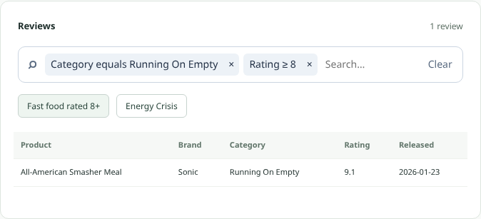

# Siftbar

**Add text search and editable filter chips to your web app, without a UI framework.**

Give Siftbar the fields users can filter on. It renders the search bar, validates
filter values, and hands your app the search text and structured conditions. Your
app decides what matches and how to display the results.

[Try the live demo](https://andyklimczak.github.io/siftbar/#playground) ·
[npm](https://www.npmjs.com/package/siftbar) ·
[API guide](docs/guide.md)

[](https://andyklimczak.github.io/siftbar/#preset-buttons)

## Features

- **Quick search and editable chips:** combine free-text search with filters such
  as **Category is Fast Food** AND **Rating is at least 8**.
- **Typed filters:** validate text, numbers, dates, booleans, and predefined choices.
- **Presets and saved filters:** apply common combinations or restore a previous search.
- **Keyboard-friendly controls** with light and dark themes and
  [localizable UI text](docs/messages.md).
- **Framework-free:** use it from JavaScript or TypeScript, with a bundler or
  directly in a modern browser. Siftbar makes no network requests.

## Quick start

```sh
npm install siftbar
```

Add a host element and somewhere to display the state for this example:

```html
<div id="filters"></div>
<pre id="filter-state"></pre>
```

In your browser entry point, after those elements are in the DOM:

```js
import { Siftbar } from 'siftbar';
import 'siftbar/styles.css';

const output = document.getElementById('filter-state');
const showState = state => {
  output.textContent = JSON.stringify(state, null, 2);
};

const bar = new Siftbar(document.getElementById('filters'), {
  fields: [
    { key: 'name', label: 'Name', type: 'text' },
    { key: 'rating', label: 'Rating', type: 'number', min: 0, max: 10 },
  ],
  onChange: showState,
});

showState(bar.getState());
```

Type a name and press Enter to commit a text search. Click the input and choose
**Rating** to add a filter; click the resulting chip to edit it. `onChange` runs
when search or filters are committed, not on every keystroke. In your app, replace
`showState` with a handler that uses `state.search` and `state.filters` to filter
local data or query your API. Validate client-provided state on the server.

### Without a bundler

Load the stylesheet and standalone script, then run the same example from
`filters.js` without the two imports. Use `new window.Siftbar(...)` in place of
`new Siftbar(...)`. Include the two host elements above in your page.

```html
<link rel="stylesheet" href="https://cdn.jsdelivr.net/npm/siftbar@0.1.0/dist/styles.css">
<script defer src="https://cdn.jsdelivr.net/npm/siftbar@0.1.0/dist/siftbar.browser.js"></script>
<script defer src="./filters.js"></script>
```

You can also self-host these files. Keep the JavaScript and CSS versions matched.

## Documentation and examples

- [API and integration guide](docs/guide.md) — field options, operators, quick
  search, presets, saved state, and teardown.
- [Live examples](https://andyklimczak.github.io/siftbar/) — see working presets,
  API-backed results, theming, and a filter bar in a dialog.
- [Message catalog](docs/messages.md) — localize controls and validation feedback.

## Contributing

Found a bug or have a feature idea? [Open an issue](https://github.com/andyklimczak/siftbar/issues).
To run the examples locally, clone the repo and run `npm ci` followed by `npm run dev`
(Node 22.19+). See the [development guide](https://github.com/andyklimczak/siftbar/blob/master/docs/development.md)
for testing and deployment.

## License

[MIT](LICENSE). Floating UI is bundled; its MIT notices ship with Siftbar.
